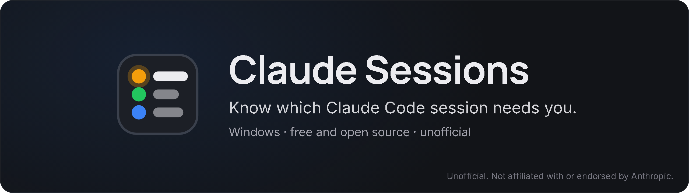
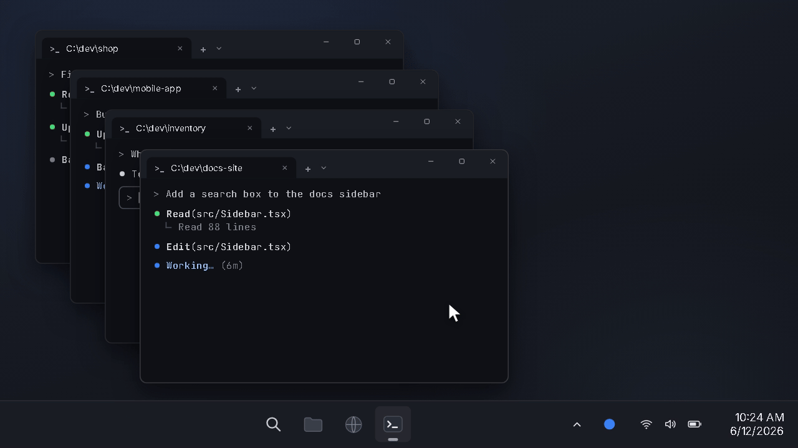

<p align="center">
  <a href="https://github.com/drknowhow/claude-sessions"></a>
</p>

<p align="center">
  <a href="https://github.com/drknowhow/claude-sessions/releases/latest"></a>
  <a href="https://github.com/drknowhow/claude-sessions/actions/workflows/ci.yml"></a>
  <a href="LICENSE"></a>
  
  <a href="https://github.com/sponsors/drknowhow"></a>
</p>

<p align="center">
  <b>A Windows tray icon for people who run several Claude Code sessions at once.</b><br>
  It tells you when a session finishes or is waiting for you, and gives each project its own sound so you know which one it was without looking.
</p>

<p align="center">
  <a href="https://github.com/drknowhow/claude-sessions/releases/latest"><b>Download the installer</b></a> ·
  <a href="#install">Install</a> ·
  <a href="#how-it-works">How it works</a> ·
  <a href="#build-from-source">Build</a>
</p>

<p align="center">
  
</p>

<p align="center">
  <a href="https://drknowhow.github.io/claude-sessions/">▶ Watch the 40-second promo with sound</a>
</p>

<p align="center"><sub>Claude Sessions is an unofficial tool. It is not affiliated with or endorsed by Anthropic.</sub></p>

## What it does

- A toast and the session's sound when a session finishes a turn, when it
  is waiting for you (a permission prompt or a question), and when a turn
  fails.
- One icon whose colour is the most urgent session: amber needs you, red
  failed, green finished, blue working.
- A popup listing every terminal session with its project, branch, first
  prompt and state.
- Clicking a session's row, its menu line or its toast brings its terminal
  window to the front.

Everything stays on your PC. The hooks talk to the tray over `127.0.0.1`
with a token, and nothing is sent anywhere else.

## Install

You need:

- Windows 10 or 11. It is built and tested on Windows 11.
- [Claude Code](https://github.com/anthropics/claude-code), run
  in a terminal.
- [Node.js](https://nodejs.org/). The hooks run a small Node script. The
  installer looks for `node.exe` in `%ProgramFiles%\nodejs\` and then on
  your `PATH`.

Then:

1. Download `Claude Sessions Setup <version>.exe` from the
   [latest release](https://github.com/drknowhow/claude-sessions/releases/latest)
   and run it. It installs for your user only and needs no admin rights.
   The installer is not signed, so SmartScreen may stop it: choose
   **More info**, then **Run anyway**.
2. The tray icon starts as a gray square with `!`, which means the hooks
   are not installed yet. Right-click it and choose **Install hooks into
   Claude Code**. Sessions that are already running pick up the hooks
   without a restart.
3. Turn on **Start at login** in the same menu if you want the tray to
   start when you sign in to Windows. It is off until you turn it on.

To uninstall, first remove the hooks and turn off Start at login from the
menu, then uninstall Claude Sessions from Windows Settings, Apps. If you
skip the first step, the hooks stay in `settings.json` and their reporter
keeps writing events to a spool file, and the login entry may stay behind.

## The icon

- Gray ring: no sessions.
- Dot: no alerts. Blue while a session is working, gray when all are idle.
- Square with a number: the most urgent colour wins. Amber means a session
  needs you, red means a turn failed, green means a session finished and you
  have not seen it. The number counts those sessions.
- Gray square with `!`: the hooks are not installed.

Hovering over the icon opens the popup after 250 ms, and it closes 300 ms
after the pointer leaves. Left-click pins it open so you can rename a
session or pick a sound; click the icon again, press Esc or click elsewhere
to close it.

Right-click opens the menu: one line per session (project, branch or alias,
first prompt, state), Do not disturb, a toggle for desktop-app and SDK
sessions, Start at login, install or remove hooks, the data folder, and
quit. Opening the menu marks finished sessions as seen. Clicking a session's
line brings its terminal forward.

## The popup

The popup is 320 px wide and follows the Windows light or dark theme.

- The header has the session counts, a bell for Do not disturb (30 minutes,
  1 hour, until 08:00, off; while it is on the bell shows the end time) and
  a gear for settings: volume, the desktop and SDK toggle, Start at login,
  and the data folder.
- Rows are sorted most urgent first: needs you, failed, finished, working,
  idle. The three most recently ended sessions follow, dimmed.
- Each row has a status dot, "project · branch" (or "project · alias" once
  you rename it), the session's name or first prompt, and a state line such
  as "Needs permission: Bash · 1m", "Done 2m ago" or "Working 6m · Edit".
- The sound chip shows the row's sound. The speaker at its left mutes or
  unmutes the session, the name opens the sound picker, and ▶ plays the
  sound.
- At the right of the title, the expand button brings the session's
  terminal window to the front, and ⋯ opens the row menu: Rename… and
  Forget, which hides the row. Pointing at a row also shows a button that
  copies its resume command (`claude --resume <id>`) and one that opens its
  folder. Ended rows have no expand button.
- A popup that stays open for half a second marks the finished rows in it as
  seen, and they turn gray.
- Clicking a row's title or state line does what the expand button does: it
  marks the session seen and brings its terminal window to the front. The
  popup closes when the window comes forward. When the window stays put, the
  state line says why for a few seconds, for example "Couldn't find its
  window".

## Sounds

- Built-in: eight tones synthesized in the app (marimba, bell, wood, blip,
  chirp, pluck, glass, low horn). They need no files.
- Windows: the `.wav` files in `C:\Windows\Media`.
- Custom: "Add sound…" in the picker copies a `.wav`, `.mp3` or `.ogg` into
  `%APPDATA%\ClaudeSessions\sounds\`.

Each new project gets the next built-in sound no other project uses, and
keeps it, so all sessions in one project sound the same. The picker sets a
sound for "This session" or for all of that project's sessions; a session's
own choice wins over its project's.

A finished turn plays the sound once. A session that needs you plays it
twice. Files longer than 2.5 seconds are cut there with a short fade.

Toasts are silent, so Windows adds no sound of its own. Muting a session or
turning on Do not disturb stops both its sound and its toast; the icon and
the popup still update.

## How it works

- Hooks in `~/.claude/settings.json` run `reporter/report.js` on
  SessionStart, UserPromptSubmit, PreToolUse, PostToolUse, Notification,
  Stop, StopFailure and SessionEnd. They are `async`, so a session never
  waits for them.
- The reporter posts each event to the tray on `127.0.0.1`, with the port
  and a per-run token from `server.json`. When the tray is not running it
  appends the event to `spool.jsonl`. The tray reads the spool at start and
  every 15 seconds. Events more than 30 seconds old are applied without a
  toast.
- The tray also watches `~/.claude/sessions/<pid>.json`, the file Claude
  Code keeps for each running process. That is how sessions started before
  the hooks were installed still show up. The format is undocumented; if it
  changes, the tray works from the hooks alone.
- Every 15 seconds the tray checks that each session's process is alive.
  Closing or killing a terminal window ends the session even when no
  SessionEnd arrives. A live process whose start time differs from the one
  in its `<pid>.json` is a new program that got a reused PID, so that
  session ends too.
- To bring a session forward, the tray walks up from its `claude` process
  to the first ancestor that owns a visible window, such as the console or
  Windows Terminal window it runs in, and focuses that window. Windows
  Terminal started as the default terminal is not an ancestor of the shell.
  For those sessions the tray picks the terminal window whose title best
  matches the session's alias, name or project, and focuses nothing if no
  title matches. The Win32 calls go through `koffi`. If it fails to load,
  `tray.log` says so and the tray runs without focus or the start-time
  check.
- "Finished" fires 1.5 seconds after Stop. "Needs you" fires on Claude
  Code's permission or question notification, or 12 seconds after the
  prompt appears if that notification never comes. Claude Code's idle
  reminder (`idle_prompt`) is ignored, so a finished turn alerts once.
- Only terminal sessions (`entrypoint` `cli`) show by default. The menu
  toggle adds Claude desktop-app sessions and SDK or `claude -p` runs.

## Hooks

Install and remove from the menu, or from a terminal in a source checkout:

```
node hooks-install.js install
node hooks-install.js uninstall
node hooks-install.js status
```

The installer:

- copies the reporter to `%LOCALAPPDATA%\ClaudeSessions\reporter\` and runs
  it with an absolute `node.exe` path;
- backs up `settings.json` to `settings.json.bak-claudesessions-<time>`
  before each write, and writes nothing if the file does not parse or
  changes while it works;
- touches only hook entries whose path contains
  `claudesessions/reporter/report.js`, so your other hooks stay as they are.

A Stop hook of your own that plays a sound keeps running, so a finished turn
plays that sound and the tray's. Remove it from `settings.json` if you want
only the tray's. Version 0.1.0 moved one Stop hook aside into
`%APPDATA%\ClaudeSessions\stashed-hooks.json` while its hooks were in;
removing the hooks puts that hook back and deletes the file.

Claude Code can also raise its own notification (the notification setting
in its `/config`, stored as `preferredNotifChannel`). If one event gives you
two alerts, turn that one off.

## Files

- `%LOCALAPPDATA%\ClaudeSessions\`: `server.json` (port and token),
  `spool.jsonl`, `state.json` (sessions, kept across restarts), `tray.log`,
  and the reporter copy.
- `%APPDATA%\ClaudeSessions\`: `config.json` (Do not disturb, the
  desktop/SDK toggle, volume, aliases, project and session sounds, muted
  sessions), `sounds\` for added sound files, and `stashed-hooks.json` if
  version 0.1.0 installed the hooks.

## Build from source

```
npm install
npm start
```

runs the tray from the checkout. Install the hooks from its menu as above.
Start at login turned on from a checkout starts Electron with that folder;
turned on from the installed app, it starts the app.

```
npm run dist
```

builds `dist\Claude Sessions Setup <version>.exe`, a per-user installer
that installs to `%LOCALAPPDATA%\Programs\claude-sessions-tray\`.

The version comes from `package.json`. The tray menu shows it above Quit,
Windows Settings, Apps lists the app as "Claude Sessions <version>", and
`tray.log` records it each time the tray starts.

`npm run icon` draws `build\icon.ico` and `docs\brand\mark.svg` from the
brand mark in `scripts/brand-mark.js`.

`npx electron scripts/render-popup.js [folder]` draws the popup with made-up
sessions, in light and dark, to PNG files, so a change to the renderer can be
looked at without a tray or a terminal.

The promo videos are a [Remotion](https://www.remotion.dev/) project in
`marketing/`. Run `npm install` and `npm run render` there.

## Tests

`npm test` runs the unit tests for the reducer, installer, registry reader,
server, config store, icon drawing, menu and toast text, the hover timing,
the popup's row model, the sound catalog and assignment, the window choice
for focus, and the liveness check. CI runs them on Windows for every push
and pull request.

`npx electron scripts/check-synths.js` renders each built-in sound offline
and fails if one is silent, clips, or runs well past the length it reports.

`docs/spike-findings.md` has the notes from the spike that came before the
build: hook payloads, timings, and what happens when a terminal window is
closed or killed. They were measured on one Windows 11 PC in October 2026,
so a newer Claude Code may behave differently.

## Known gaps

- An idle session's time counts from when the tray first saw it, not from
  its last turn.
- Focus picks a window, not a tab. Windows Terminal runs all its tabs in
  one window, so with several sessions in one window the tray brings the
  window forward and you pick the tab.
- A Windows Terminal window's title is its active tab's title. A session
  the tray can match only by title is found while its tab is the active
  one, or while another window's title names the same project; then the
  topmost of those windows comes forward.
- Claude desktop-app sessions focus the Claude app. Remote Control bridges
  and SDK runs have no window: clicking one marks it seen, and in the popup
  its row says it couldn't find the window.
- A failed turn plays the same pattern as a finished one.
- `/clear` starts a new session id, so the session loses its alias, its own
  sound and its mute.
- Forget hides a live session only until its next prompt.
- Windows only. The focus and process code uses Win32 calls.

## License

MIT. See [LICENSE](LICENSE).

Claude Sessions is an unofficial tool. It is not affiliated with or
endorsed by Anthropic. "Claude" and "Claude Code" are trademarks of
Anthropic.
